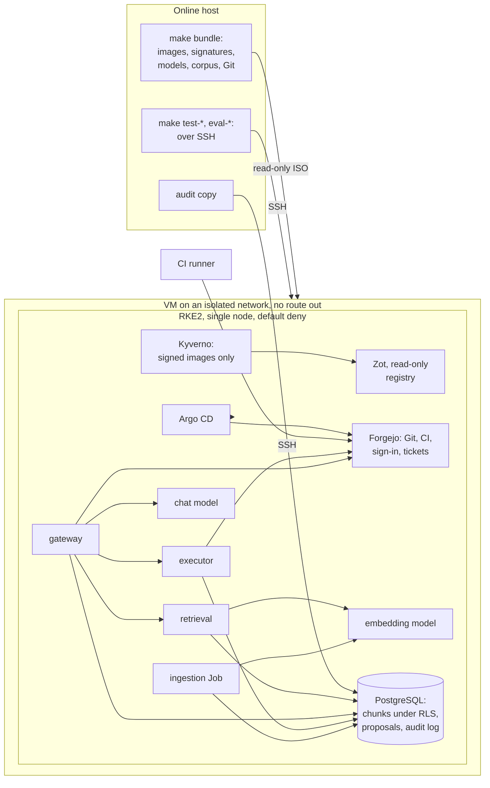

# Architecture

A short description of how the stack is built, and where each of its rules is enforced. The
[threat model](threat-model.md) says what each rule defends against, and the [ADRs](adr/) say why
each was chosen and what was measured. This page names them and does not repeat them.

## What it is for

A maintenance-manual assistant, in a single-node lab behind a simulated air gap. A technician or an engineer signs in, asks a
question, and gets an answer that cites passages from the manuals their role may read. The model may
propose a maintenance ticket; only the user, on a separate page, can confirm it, and only then is it
filed. The manuals are a pinned slice of the Kubernetes documentation (CC BY 4.0), with some paths
labelled restricted as a synthetic stand-in for text above a technician's role. The models are
Ministral 3 3B Instruct for answers and nomic-embed-text v1.5 for embeddings, on
CPU. Both licences are Apache-2.0, as their Hugging Face records state (ADR 0010).

Three properties matter, as the threat model states them: no ticket without a valid confirmation from
an authenticated user, no text above a reader's role in an answer or a ticket, and an audit log whose
rewriting is detectable. All of it inside network layers that, in the paths tested, let nothing out.

## Deployment

- **The host builds, the VM runs.** `make bundle` builds everything the VM needs on the online host:
  packages, RKE2, images, the models, the corpus and the Git repository, onto a read-only ISO
  (ADR 0004). The host signs the images it puts in the registry with a key whose public half alone
  enters the bundle (ADR 0006). For an image built elsewhere, such as Forgejo, Argo CD, llama.cpp or
  pgvector, the signature says only that this digest was mirrored here, pinned by digest. The VM
  needs nothing from outside, and the egress tests found no path out open.
- **The air gap has layers, each tested with a control** (ADR 0008): the VM's default route is a
  black hole, the host's firewall drops the VM's traffic to the outside and to host services, and a
  default-deny Calico policy in the cluster allows only the paths below (ADR 0003). The egress tests
  open each layer in turn and show the path then works, so a blocked result means the layer blocked
  it.
- **One node.** RKE2 on one VM, with restricted Pod Security on every namespace except
  `kube-system` and `zot`, which needs `hostPath` (ADRs 0005, 0006).
- **Git inside the air gap drives the cluster.** Forgejo holds the repository the bundle brings in.
  Argo CD applies `deploy/` from it, and Forgejo's own CI runs a secret scan on it (ADR 0007). Images
  come from Zot, a read-only registry. Kyverno admits only images signed by the host's key, except in
  `kube-system`, `kube-public` and `kube-node-lease`, which run RKE2's own images from the bundle, and
  in `zot` and `kyverno`, which cannot check themselves (ADR 0006).
- **The host keeps a copy of the audit log,** read over SSH, so that a rewrite inside the VM, even one
  with every hash recomputed, shows against it (ADR 0024).

## Building blocks

Each component, what it does, and the only paths the network rules give it.

| Component | Namespace | Does | Reaches | ADRs |
|---|---|---|---|---|
| gateway | `gateway` | Sign-in through Forgejo, the chat loop, the chat and confirmation pages, proposals, the audit log | chat model, retrieval, executor, PostgreSQL, Forgejo | 0015, 0017, 0018, 0021 to 0023 |
| executor | `gateway` | Checks a confirmation and files the ticket; holds the only Forgejo token that can | PostgreSQL, Forgejo | 0016, 0021 |
| retrieval | `retrieval` | Searches the chunks as the caller's role, and looks up a proposal's sources | embedding model, PostgreSQL | 0014 |
| PostgreSQL | `retrieval` | Chunks with row-level security; the gateway's own database | nothing | 0012, 0016 |
| ingestion Job | `retrieval` | Chunks, labels and embeds the corpus from its image | embedding model, PostgreSQL | 0013 |
| chat model | `inference` | llama.cpp serving Ministral 3 3B Instruct | nothing | 0010, 0011 |
| embedding model | `inference` | llama.cpp serving nomic-embed-text v1.5 | nothing | 0010, 0011 |
| Forgejo | `forgejo` | Git, users and teams, the ticket repositories | nothing | 0007, 0017, 0021 |
| CI runner | `forgejo` | Runs Forgejo's CI jobs | Forgejo | 0007 |
| Argo CD | `argocd` | Applies `deploy/` from Forgejo | itself, the API server, Forgejo | 0007 |
| Zot | `zot` | The read-only registry | nothing | 0006 |
| Kyverno | `kyverno` | Admits signed images only, outside the exempt namespaces | the API server, Zot | 0006 |

The Go services are static binaries on an empty base, built so that the same source gives the same
digest, and `infra/versions.env` pins every digest that `deploy/` names.

## A question, and a ticket

1. **Sign-in.** The browser reaches the gateway through a port-forward and signs in through Forgejo.
   The gateway reads the user's teams there: `technicians` or `engineers` (ADR 0017).
2. **The question** is stripped of e-mail addresses, phone numbers, IBANs and card numbers before
   anything else sees it (ADR 0023).
3. **The loop.** The gateway sends the question and two tools to the model, and runs what the model
   calls, up to a fixed number of calls (ADR 0018). `search_manuals` searches as the session's role,
   whatever the model writes; the model chooses only the query. Retrieval sets that role in the
   database transaction, and row-level security decides which chunks it can see (ADRs 0012, 0014).
4. **The answer** is shown only if it cites a passage the turn found, and as escaped text marked as
   written by the model (ADR 0022). Otherwise the page says no answer is shown.
5. **A proposal.** `create_ticket` only stores a proposal, with its arguments in canonical form, their
   hash, and the passages the gateway's own searches found as its sources. The loop has no way to
   confirm: the code it runs holds no confirmation or execution path (ADRs 0015, 0018).
6. **Confirmation.** The user opens the proposal page, which shows the stored arguments, each source's
   text read with the user's role, and who will be able to read the ticket. A POST with the session's
   CSRF token confirms it, and a one-time token goes straight from there to the executor (ADR 0017).
7. **Execution.** The executor checks, in one transaction, the token, the user, the tool, the
   arguments' hash and the user's role at that moment in Forgejo, then files the canonical arguments,
   to the restricted repository if any source was restricted (ADRs 0016, 0021).
8. **The audit log** records every proposal, confirmation and execution, refused or allowed, in a hash
   chain (ADR 0015), copied off the VM after each rebuild (ADR 0024).

## Where each rule is enforced

The design puts each rule where the model cannot reach it.

| Rule | Enforced by | Not by |
|---|---|---|
| No ticket without the user's confirmation | The approval core's checks in the executor, and a loop that cannot reach them | The prompt |
| A search uses the user's role | The gateway's session, and row-level security in PostgreSQL | The model's arguments |
| A ticket is readable only by roles that may read its sources | The proposal's sources, recorded by the gateway, and Forgejo's team permissions | What the model writes |
| An answer shows its sources | The gateway's citation check | The model's honesty |
| Nothing leaves, on the paths tested | Three network layers, each tested with a control | Any component's good behaviour |
| Outside the exempt namespaces, only images signed by the host's key run | Kyverno and the read-only registry | The manifests |

## How it is checked

- **`make rebuild`** destroys the VM, builds the bundle and the VM again, and runs the tests that need
  the VM: hardening, signed images, GitOps, row-level security, ingestion, retrieval, the executor,
  the gateway, the compromised-model stub, planted prompt injections, the audit copy and the egress
  layers. It then copies the audit log and runs the retrieval gate, and with `EVALS=generation` the
  generation gate's pair (ADR 0028). The guard and database tests run outside it, in CI.
- **The eval gates** compare retrieval and the model's answers on a golden set of 47 questions with
  saved baselines (ADRs 0025, 0026). A candidate gateway runs beside the deployed one, and a
  deliberately worse prompt fails the gate while an unchanged copy passes (ADR 0027).
- **CI on GitHub** runs the secret scan, the linters, the unit tests, including the gates' own, and
  the database tests on every change (ADRs 0009, 0028). It has no VM, so it does not test the
  deployment.

The [evidence index](evidence.md) lists each claim with its test, its latest run and what the test
does not prove.

## Limits

These are the limits of the design, not only of its tests:

- **One node, one VM, one host,** with no high availability and no day-2 operations: no upgrades,
  backups or monitoring.
- **One action, filing a ticket,** which is low in consequence. An action that changes a real system
  would need more than one person's confirmation.
- **No real users,** only test accounts, and no independent review.
- **CPU only.** A turn takes tens of seconds, and nothing here is measured on a GPU.
- **No TLS inside the cluster.** Identity between services rests on the network rules.
- **A misled user can still confirm a harmful proposal.** The confirmation page shows what will be
  filed and where it came from, but a person decides.
